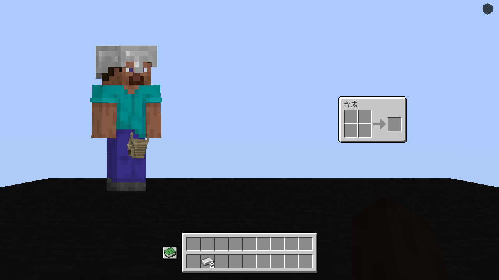
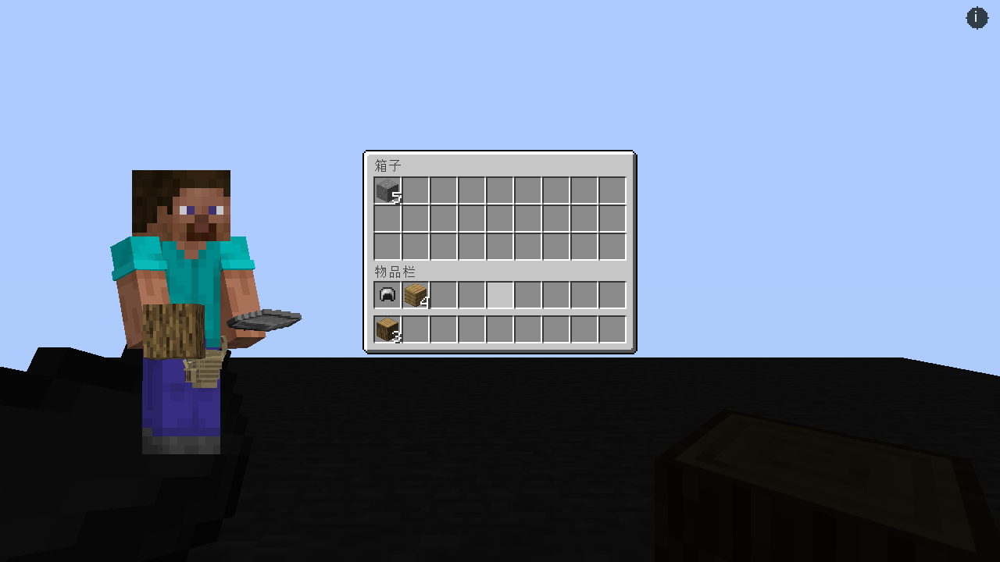
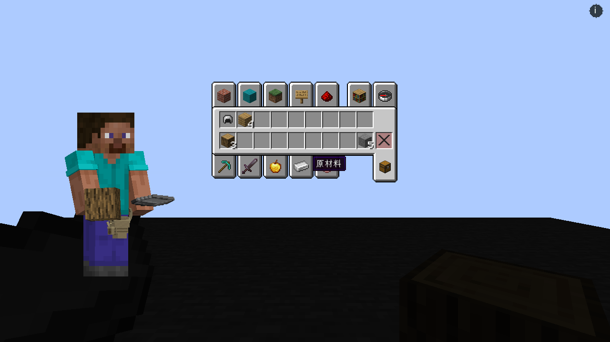

# BS3D Pocket Addon

把原版主背包收成「贴身口袋 9 格 + 快捷栏 9 格」的可选 BS3D 附属。原版 E 页直接改成三维人物、2×2 合成和底部两行；更多容量只能靠 BS3D 的随身容器。

Fabric 1.20.1 · Java 17 · MIT · `0.1.0-SNAPSHOT`，尚未发布正式版本，API 未冻结。

- **可选安装、装上即生效、卸载后 18–35 号槽恢复可用。** `PlayerInventory` 仍是原版 36 格结构，存档格式、死亡掉落和原版命令不变。
- 18–35 号槽视为不存在：拾取、`/give`、Shift 搬运、合成取出、`insertStack` 都只在 0–17 内寻位，放不下按原版背包满掉在脚边。服务端拒绝伪造的旧槽点击与创造模式写入。
- 旧存档或其他模组写进 18–35 的物品，在登录、重生和每个服务器 tick 依次搬进口袋、随身容器，仍放不下的掉在脚边，动作栏提示一次并记一行日志，不静默删除。
- E 页：左侧可旋转、可抓取的玩家模型，右侧 2×2 合成（打开身上容器时由内景替代），底部口袋行加快捷栏。原版二维盔甲与副手槽由模型部位代替，配方书按钮保留。
- 创造模式「物品栏」页签与 E 页同一做法：左侧同一个可旋转的三维人物，物品拖到模型上穿戴或持握、从模型取下放回槽位；窗口只留口袋行、快捷栏和删除格。搜索页与物品类别页签不变。
- Vanilla-Addon 已适配的工作站与容器页，玩家区同样只画两行；未适配的第三方菜单保持三行显示，服务端规则照样生效。
- 只读常量 `PocketSlots.VISIBLE_MAIN_SLOTS = 9`，没有配置项。

截图来自真实 Fabric 客户端联调；另见[旧存档整理提示](docs/images/legacy.png)。

接入文档唯一来源为 [docs/wiki](docs/wiki/Home.md)：[安装与构建](docs/wiki/Getting-Started.md) · [操作与兼容范围](docs/wiki/Interaction.md) · [规则与接入点](docs/wiki/Protocol.md) · [验证记录](docs/wiki/Validation.md)。

依赖 [Inventory UI Framework](https://github.com/Kizunad/Kizuna-Inventory-UI-Framework)、[Backpack and Storage 3D](https://github.com/Kizunad/backpack-and-storage-3D) 与 BS3D Vanilla Addon；三者都必须安装，本附属不提供缺失依赖时的退化分支。
